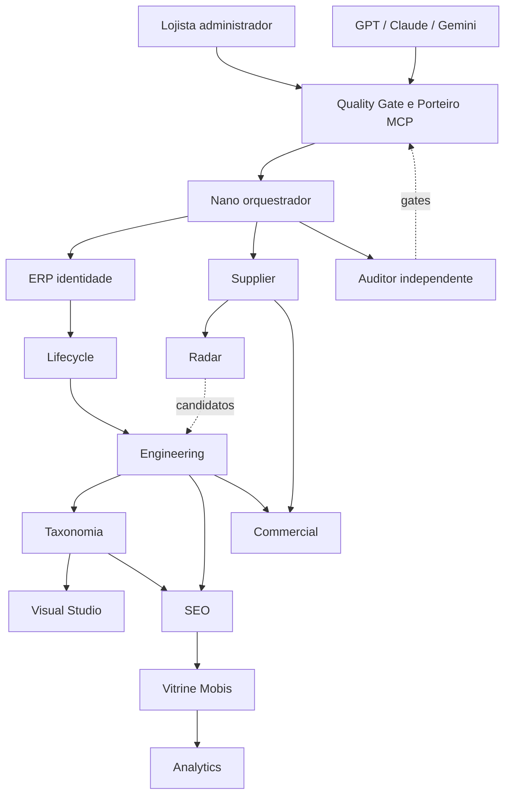

# Matriz Mestra Nano Ecosystem 1.0.0
26/11/2026 — execução incremental autorizada pelo lojista. Não é autorização para compras, envio, alteração fiscal, preços, saldo, publicação de novos itens ou contorno de acesso.
## Modelo mental

Feedback Radar/Analytics é entrada de nova revisão, não dependência circular de execução. Modelos lógicos e métricas em `supabase/functions/_shared/nano_lifecycle/matriz_mestra.ts`. Reusar banco e pipeline existente; não criar tabelas redundantes. O mapa lógico representa dependências para aceite integrado, não impede desenvolvimento paralelo nem pré-compra sem SKU existente: consulta comercial prévia é fluxo candidato, não aprovação de aplicação física. Ausência de evidência = pendência, não 100%; índice é fração de gates na revisão, não probabilidade de acerto. Dashboard futuro deve mostrar numerador/denominador, data, referência e revisão; dados indisponíveis = não medido. Nenhum agente pode declarar sua própria aprovação. Separação real de privilégios e adaptador de evidências ainda pendentes.
## Ordem executiva e aceites
1. Vitrine: corrigir falha de regressão CI mantendo publicação explícita e produto ativo. Homologar filtros, busca por código, links por aplicação, mobile. Não alterar layout aprovado no PR #506. 
2. SEO: adaptar rota SSR por slug de aplicação, canonical/sitemap e segurança sem preço; auditar versão implantada e domínio.
3. Identidade/Lifecycle: reconciliação por loja+ID Bling+SKU, checkpoint/outbox, consumidor persistente e testes concorrentes. Só então ativar para novos produtos, sem backlog em massa.
4. Engenharia/taxonomia: mapeamento por fato e fonte, ano/motor/mercado, OEM por aplicação, fabricantes distintos de marcas; nova raiz proposta e sem duplicidade.
5. Visual Studio e dashboards: renderização tipada e métricas reais; preview ERP sem escrita até aprovação do campo e readback.
6. Commercial/Supplier/Radar: fila privada, sessão dedicada e permissão por portal, cotação e proposta como minutas, sem compra; validar condições e orçamento.
7. Analytics e auditoria: Search Console e eventos comprovados, rollback, gates independentes, homologação 1/10/20/100 SKUs e ampliação conforme resultados. 
## Referências locais (não substituídas)
- nano-lifecycle-20261126.md
- nano-lifecycle-projecoes-nos-20261126.md
- nano-commercial-intelligence-20261126.md
- nano-visual-studio-distribuidores-20261126.md
- nano-supplier-intelligence-rmp-radar-20261126.md
- nano-vitrine-enriquecida-20261126.md
- multiagente-arquitetura.md; ../ordem-mestra/05-contratos-ferramentas.md
## Limites
Contratos puros e testes desta etapa não são dashboard integrado, worker implantado ou auditor independente em produção. Não usar credenciais compartilhadas para aprovação. Toda implantação precisa de CI verde, verificação visual e leitura de retorno, rollback e preservação da produção. 
