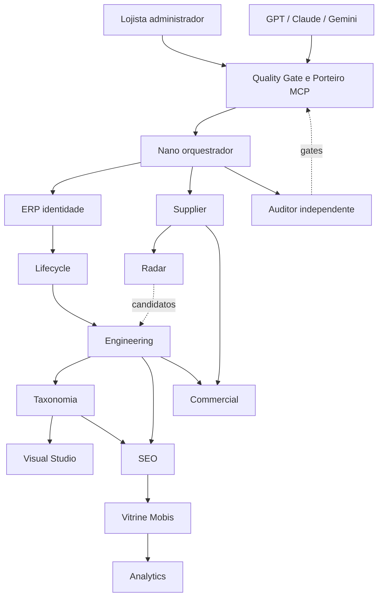
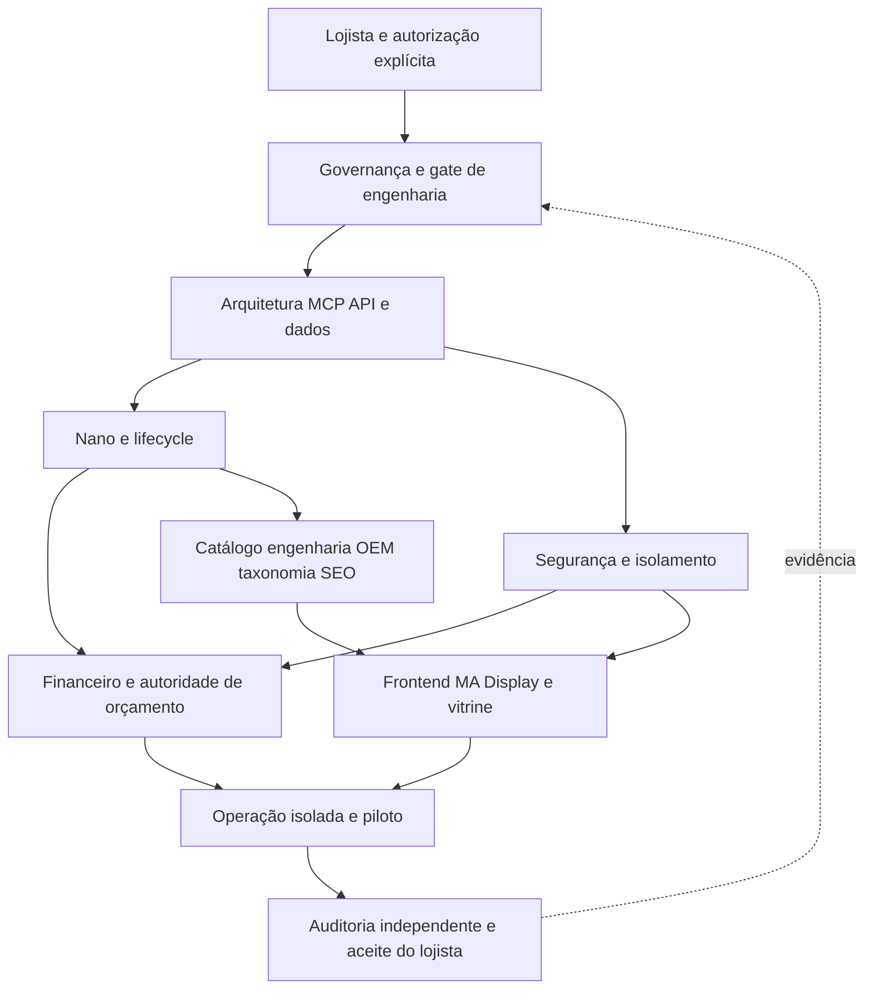

# Matriz Mestra Nano Ecosystem 1.0.0
26/11/2026 — execução incremental autorizada pelo lojista. Não é autorização para compras, envio, alteração fiscal, preços, saldo, publicação de novos itens ou contorno de acesso.
## Modelo mental

Feedback Radar/Analytics é entrada de nova revisão, não dependência circular de execução. Modelos lógicos e métricas em `supabase/functions/_shared/nano_lifecycle/matriz_mestra.ts`. Reusar banco e pipeline existente; não criar tabelas redundantes. O mapa lógico representa dependências para aceite integrado, não impede desenvolvimento paralelo nem pré-compra sem SKU existente: consulta comercial prévia é fluxo candidato, não aprovação de aplicação física. Ausência de evidência = pendência, não 100%; índice é fração de gates na revisão, não probabilidade de acerto. Dashboard futuro deve mostrar numerador/denominador, data, referência e revisão; dados indisponíveis = não medido. Nenhum agente pode declarar sua própria aprovação. Separação real de privilégios e adaptador de evidências ainda pendentes.
## Ordem executiva e aceites
1. Vitrine: corrigir falha de regressão CI mantendo publicação explícita e produto ativo. Homologar filtros, busca por código, links por aplicação, mobile. Não alterar layout aprovado no PR #506. 
2. SEO: adaptar rota SSR por slug de aplicação, canonical/sitemap e segurança sem preço; auditar versão implantada e domínio.
3. Identidade/Lifecycle: reconciliação por loja+ID Bling+SKU, checkpoint/outbox, consumidor persistente e testes concorrentes. Só então ativar para novos produtos, sem backlog em massa.
4. Engenharia/taxonomia: mapeamento por fato e fonte, ano/motor/mercado, OEM por aplicação, fabricantes distintos de marcas; nova raiz proposta e sem duplicidade.
5. Visual Studio e dashboards: renderização tipada e métricas reais; preview ERP sem escrita até aprovação do campo e readback.
6. Commercial/Supplier/Radar: fila privada, sessão dedicada e permissão por portal, cotação e proposta como minutas, sem compra; validar condições e orçamento.
7. Analytics e auditoria: Search Console e eventos comprovados, rollback, gates independentes, homologação 1/10/20/100 SKUs e ampliação conforme resultados. 
## Referências locais (não substituídas)
- nano-lifecycle-20261126.md
- nano-lifecycle-projecoes-nos-20261126.md
- nano-commercial-intelligence-20261126.md
- nano-visual-studio-distribuidores-20261126.md
- nano-supplier-intelligence-rmp-radar-20261126.md
- nano-vitrine-enriquecida-20261126.md
- multiagente-arquitetura.md; ../ordem-mestra/05-contratos-ferramentas.md
## Limites
Contratos puros e testes desta etapa não são dashboard integrado, worker implantado ou auditor independente em produção. Não usar credenciais compartilhadas para aprovação. Toda implantação precisa de CI verde, verificação visual e leitura de retorno, rollback e preservação da produção. 

## Anexo — mapa integrado de qualidade de engenharia e MA Display
26/11/2026. Complementa, não substitui, a ordem executiva, contratos e limites acima. Controle documental; não habilita produção.
### Mapa de dependências para aceite

### Regra de qualidade 1,00
Para cada revisão e bloco, registrar identificador do gate, SHA, ambiente, método, numerador, denominador, artefato, resultado, data e responsável pela revisão. Índice de CI = aprovações / jobs aplicáveis; ignorados só excluídos com justificativa. Índice de aceite integrado = gates obrigatórios satisfeitos / gates obrigatórios previamente definidos. Pendência, ausência de evidência, falha ou não medido não equivalem a aprovação. Não reduzir o denominador para atingir a meta; não usar média para compensar falha crítica. Gate de liberação exige 1,00 em cada bloco obrigatório, sem falhas críticas, evidência visual do mesmo SHA e revisão independente. A meta não é probabilidade nem garantia absoluta. O executor não declara parecer independente próprio.
### Critérios por bloco
| Bloco | Evidências obrigatórias |
|---|---|
| Governança | Matriz rastreável; escopos, autoridades, autorização, revisão e limites explícitos |
| Arquitetura | Contratos API/MCP, schema e rollback testados; sem duplicar autoridade |
| Nano | Ciclo de vida, idempotência, concorrência, filas, isolamento, persistência e recuperação |
| Segurança | Testes negativos, RLS, menor privilégio, ausência de bypass, proteção de caminhos legados |
| Financeiro | Reservas e confirmações concorrentes, autoridade administrativa, competência original, imutabilidade, histórico e revisão independente |
| MA Display | Referência aprovada e inventário de logos, ícones, fontes, tokens, layouts e película; testes da implementação e capturas do mesmo SHA |
| Catálogo | Fonte por fato, OEM e SKU homologados, ano/motor/mercado, marcas distintas, imagens fiéis, SEO, sem preços não autorizados |
| Operação | E2E com dados sintéticos, falhas/reversão, latência medida contra critérios acordados, piloto escalonado 1/10/20/100 somente com autorização |
| Aceite | Relatório consolidado, auditor distinto do executor, aprovação visual do lojista, plano de reversão e autorização específica antes de publicação |
### Gate visual separado do funcional
- Preservar geometria MA e tipografia aprovada; não inventar substitutos. Manter temas e identidade Mobis (grafite #1F2327, vermelho oficial, película, fundo branco para fotos de produtos). Confirmar tokens exatos com a referência aprovada, não inferir valores faltantes.
- Inventariar ícones de navegação, categorias, veículos e peças; usar referências reais/licenciadas e registrar origem. Não confundir atalhos ilustrativos com evidência de aplicação. Não considerar CSS prismático equivalente à biblioteca completa de ícones e alfabeto.
- Comparar início, Nano, catálogo, vitrine e ficha com referência aprovada; validar 360/390/412/1280 px, contraste, acessibilidade, navegação, ausência de overflow, não regressão de filtros e escopo por loja. Registrar capturas e aceite visual humano; não substituir por CI funcional verde.
- Integrar seletivamente a branch visual, preservar alterações funcionais divergentes de LojaMobisNova.tsx. Não fazer merge na main nem deploy por este documento.
### Baseline verificado
- PR #507, SHA c55661c8615a70530233bb71d8437beb7aa5b339: 86 commits, 145 arquivos, 14/14 jobs aplicáveis aprovados, um job de publicação ignorado, draft e sem merge. Autoridade administrativa em minuta CI; não é atribuição real de papel.
- PR #506, SHA 232c42eb99a3a20eca62ef499c8458925d126ca0: 5 commits, 10 arquivos, 11/11 jobs aplicáveis aprovados, um ignorado, draft e sem merge. Camada Prismatic Pro e atalhos ilustrativos; inventário completo e aceite integrado pendentes.
- Bloqueio anterior da ferramenta impediu a integração visual; não houve commit dessa tentativa. Não contornar bloqueio. Integração requer execução permitida e nova homologação.
### Ordem imediata
1. Consolidar documentação (este anexo), homologar a revisão documental.
2. Integrar visual em ambiente permitido, preservar contratos funcionais; exigir capturas novas e revisão MA Display.
3. Retomar competência retroativa, imutabilidade, cascatas e caminhos legados com gates incrementais.
4. Obter parecer independente, demonstrar E2E isolado e consolidar demais dependências da ordem executiva original. Não confundir fechamento do bloco financeiro com conclusão do ecossistema.
5. Submeter relatório e aceite visual/operacional ao lojista; produção exige autorização própria.

## Complemento de paleta MA Display — 26/11/2026
Correção expressamente solicitada pelo lojista: incluir aço escovado e azul na paleta de temas, preservando todos os tokens originais Mobis M-STYLE V3 (grafite #1F2327, vermelho #E2181A, cinza #BFC3C7, aço #A6A6A6, branco #FFFFFF e gelo #EAF2F6). Aço escovado é acabamento/textura metálica sobre base #A6A6A6, não substituição do aço sólido; azul auxiliar tecnológico #0D47A1 é referência proposta para amostra e aceite visual, não alegação de token original V3. Uso em superfícies, ícones, contornos e película; preservar legibilidade, temas, alto contraste, geometria MA e lettering original. Fotografias de produto permanecem fiéis sobre fundo branco; não recolorir logos nem imagens. Exigir amostra e captura integrada do mesmo SHA, testes de contraste e aprovação visual. Atualização apenas documental, sem alterar CSS, código, dados, produção, preço, orçamento, ERP ou publicar paleta. Integração visual segue pendente e sujeita a execução permitida. Base #507 commit 87 e32092931317524f510ef71cb15cfdc7ea33d934: 14/14 jobs aplicáveis aprovados; publicação ignorada.

## Anexo — linguagem universal de ícones e roteamento semântico (27/11/2026)
Diretriz do lojista: todos os ícones presentes e futuros obedecem ao padrão visual universal MA Display e representam nós de um mapa semântico comum ao frontend, catálogo, mapas mentais e agentes. Não substituir o modelo de dados por reconhecimento visual.
- Separar identidade semântica estável (node_id, node_type, icon_id, versão), apresentação (SVG de referência, paleta, acabamento, estado acessível) e relações tipadas entre nós (origem, destino, tipo de relação, escopo loja, fonte e estado de homologação). Estes nomes são proposta de contrato documental, não schema implantado. Reutilizar identificadores e contratos existentes quando disponíveis; não duplicar autoridade.
- Montadora, modelo, geração, ano, mercado, motor, tração, combustível/propulsão, sistema, componente, OEM, SKU e aplicação são dimensões distintas. Hyundai HR e Kia Bongo devem ter representações visuais específicas por modelo e geração quando a referência homologada existir. Baú/carroceria não identifica motor nem tração. 4x2 não implica eixo traseiro motriz; distinguir eixo quando comprovado. Diferenciar diesel, gasolina, etanol, flex, elétrico e híbrido; subdividir híbridos quando houver documentação. Não inferir especificações por foto, nome, cor ou ícone.
- Rota ilustrativa: montadora > veículo > configuração técnica > sistema > componente > identidade OEM/SKU > aplicação homologada; o grafo admite relações múltiplas e caminhos alternativos comprovados. Porteiro valida escopo, autorização, proveniência, compatibilidade e destino antes de qualquer ação. Ícone é orientação, nunca autorização nem prova de aplicação. Ausência de fato = desconhecido/pendente, sem inventar rota.
- Estilo: contorno técnico automotivo uniforme, fundo branco nas referências de produtos, variantes grafite, vermelho, azul, branco, gelo e aço escovado; geometria constante em variantes. Preservar logos oficiais e lettering originais, não tratar imagens geradas de montadoras ou veículos como ativos oficiais ou fotografias de referência. Usar fontes e ativos autorizados. Cabeçote permanece componente da categoria motor.
- Inventário futuro: cada ícone exige chave única, rótulo acessível, conceito, referência, versão, variantes, vínculos permitidos e teste de ausência/colisão. Novo ícone não cria categoria nem relação automaticamente; extensão passa por revisão, compatibilidade de versões, teste de renderização responsiva, contraste e aprovação do lojista. Manter fallback explícito sem falsear identidade.
- Aceite 1,00 por bloco: cobertura integral do inventário obrigatório previamente definido, zero colisões de IDs, zero rotas indevidas nos cenários de teste, referências e relações rastreáveis, contraste e capturas aprovadas, auditoria independente. Sem evidência não há homologação. A meta é fração de gates satisfeitos, não garantia absoluta.
- Base #507 commit 88 e435d1c9be13005f425c61037935d93bda01974a: 14/14 jobs aplicáveis aprovados; publicação ignorada. Esta atualização é exclusivamente documental; não altera frontend, taxonomia, rotas reais, dados, ERP, preços, orçamento ou produção. Integração frontend anteriormente bloqueada continua pendente; não contornar restrição. Amostras visuais da conversa são conceituais e ainda não constituem biblioteca vetorial homologada.

## Checkpoint 90 — continuidade técnica do portfólio
Base 3208ce1309c2120eb07e97a80292c0e6440999f2, commit 89: 14/14 jobs aplicáveis aprovados; publicação ignorada. Retomar engenharia no módulo existente de projeções, sem consultas ao catálogo operacional. Introduz resolução visual pura e testes sintéticos por nó existente, com níveis compacto/3D/EPC e expansão de tecnologias; preserva identidade e rejeita colisão, falta de evidência/direitos ou mistura de lojas. Não é biblioteca de imagens pronta, integração frontend, cadastro ou indexação Google. Próximo gate: homologar CI, revisar ativos e integração autorizada, manter competência retroativa e imutabilidade financeira pendentes. Não confundir ensaios visuais com código integrado.

## Checkpoint 91 — registro universal versionado
Base 508c0f6c3dc99a9a24c79ce11630bd18ea638b52 (90): 14/14 jobs aplicáveis aprovados, publicação ignorada. Implementa manifesto puro de ativos por nó existente, identidade estável dentro do manifesto, revisão vigente explícita, histórico/revogação, fonte, hash declarado e acessibilidade. Testes VIS-91-01 a 05. Não cria taxonomia, não escreve no ERP, não obtém acervo externo, não verifica bytes/licença real nem persiste histórico. Próximo gate: homologar CI e definir projeção de rastreabilidade visual por montadora/modelo/geração/mercado usando fatos aprovados; depois integrar acervo e frontend em execução permitida, com aceite visual. Financeiro retroativo/imutabilidade e auditoria independente continuam pendentes. Bloqueio anterior da integração frontend não deve ser contornado.

## Checkpoint 92 — rastreabilidade visual contextual
Base be0b07f3bd50bc6fada1d1e1d2901cd0d06992cb (91): PR #507 draft, 14/14 jobs aplicáveis aprovados; publicar-homologacao ignorado (sem deploy). O incremento 92 acrescenta projeção pura por aplicação existente, loja, produto, montadora, modelo, geração e mercado exatos; vínculo aprovado por nó, nível e revisão vigente. Sem vínculo aprovado retorna texto; sem contexto aprovado não publica projeção; conflito de identidade/escopo falha fechado. VIS-92-01 a 06, fixtures sintéticas multicontinentes, elétrico/híbrido. Não altera filtro público BR vigente, taxonomia, frontend, dados, preços, ERP ou produção; nenhuma consulta operacional. Adaptador autorizado ainda deve validar evidência, mercado canônico, licença, bytes e unicidade global; contrato não constitui acervo real, publicação ou aprovação visual. CI 92 pendente. Próximo gate: homologar CI, consolidar biblioteca e direitos, estrutura de página universal, integração visual somente em execução permitida; controles financeiros retroativos/imutabilidade e auditoria independente permanecem obrigatórios.

## Checkpoint 93 — consolidação lógica da biblioteca universal
Base 9465d41d589be6ecd7f81d94c68e834dafdbca2f (92): 14/14 jobs aplicáveis aprovados, publicar-homologacao ignorado; VIS-92-01 a 06 aprovados nos logs de funções. Incremento 93 acrescenta validação pura de transição entre manifestos completos: identidade e metadados históricos imutáveis, próxima revisão sequencial, uma inserção por ícone por transição, revogação definitiva e veto a ativo/digest revogado inclusive alias. Cobertura medida por inventário obrigatório aprovado, não pelos ativos disponíveis; ausência é pendência, denominador vazio ou duplicado é erro. Níveis compacto/3D/EPC permanecem distintos; EPC só exigível conforme inventário explícito, sem reduzir denominador para aprovação. VIS-93-01 a 07 sintéticos. Não comprova armazenamento imutável, autoridade persistente, concorrência, bytes, licença ou acervo gráfico; adaptador confiável deve carregar snapshot anterior completo/autenticado, garantir CAS/transação e verificar evidências. Sem catálogo operacional, produção, preços, ERP, frontend ou schema. CI 93 pendente. Próximo gate: homologar CI; estruturar padrão universal de página de produto; acervo real e integração frontend permanecem condicionados à execução autorizada. Financeiro retroativo/imutabilidade e auditoria independente continuam obrigatórios.

## Checkpoint 94 — ficha universal e autorização contínua
Base d2b5ca0328f64b389d7e8c7b31e8ef14e953d3a6 (93): 14/14 jobs aplicáveis aprovados; publicação ignorada; VIS-93-01 a 07 aprovados. Implementa projeção pura de ficha individual no mercado público BR, reutilizando elegibilidade, IDs, OEM por aplicação, MPN aprovado, categoria e contexto visual em três níveis. Centraliza veto de leitura de alias revogado no manifesto. VIS-94-01 a 05 sintéticos. Não altera rota, layout, SEO implantado, banco, Bling ou preços. CI pendente.
### Gate transversal de preservação patrimonial
Lojista autorizou continuidade dos incrementos de desenvolvimento sem confirmação a cada commit, em 27/11/2026. Não revoga bloqueios de segurança nem autorização específica de produção/publicação. Antes de aceite integrado, inventariar em baseline versionada os nós e relações (IDs, escopo, fonte, estado), MCPs e ferramentas (contrato, parâmetros, retorno, escopo, permissões), APIs, filas, funções, integrações, dados e histórico. Comparar com candidato; exigir correspondência por identidade e testes de regressão por capacidade homologada, sem deduzir inventário de resultados parciais. Duplicidade/obsolescência exige reconciliação documentada, aliases ou migração reversível, preservação histórica e aprovação de desativação; não excluir nem remapear por aparência. Denominador obrigatório pré-fixado; ausência, conflito ou falta de prova = pendência. Inventário de código em Git é permitido; inventário operacional real, acesso EPC licenciado e revalidação de conexões reais só na fase autorizada. Não declarar gate concluído a partir de documentação. Evidências de rollback, contratos, RLS, auditoria independente e aceite humano para liberação.
Ordem de conclusão gerencial: biblioteca; ficha/taxonomia/SEO; MA Display; três projeções; lifecycle; financeiro; MCPs/legado/Supplier/Radar; E2E/Analytics/auditoria; piloto/implantação. Dependências prevalecem sobre sequência; nenhum avanço por CI pendente. Produção continua fora do escopo atual.

## Checkpoint 95 — três destinos, identidade física única
Base a032dad609ea4ae2e5d9dad2a2defa30c3e4163c (94): 14/14 jobs aplicáveis aprovados, publicação ignorada; VIS-94-01 a 05 aprovados nos logs. Incremento 95 cria despacho puro de projeção por destino no módulo existente: site público usa ficha 94 e publicação explícita; Conecta privado usa identidade física, fatos BR e IDs de pendências; ERP recebe apenas prévia textual dos dois campos existentes, sem mídia legada ou escrita. Reutiliza elegibilidade, valida manifesto e escopo, não confunde candidatos ou mercados externos com aplicações BR. INT-95-01 a 06 sintéticos. Destino escolhido não é autorização; adaptador autenticado deve impor permissões e nunca serializar projeção privada em endpoint público. Nenhum endpoint, frontend, banco, ERP, produção ou SEO implantado foi alterado. Preservar rotas SEO atuais e prova independente; próxima etapa: ponte de evidências para SEO e inventário patrimonial de código, ou controles financeiros/lifecycle executáveis conforme dependências e bloqueios. CI 95 pendente.
