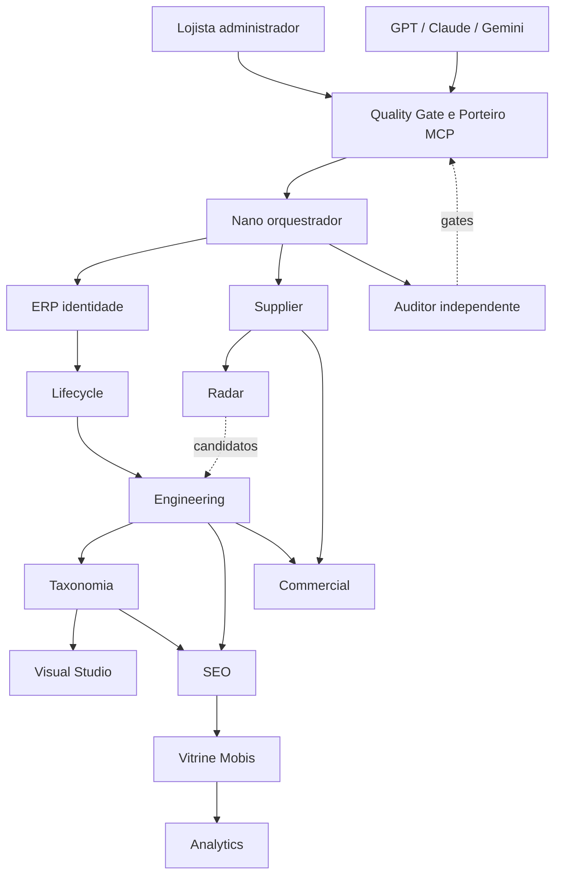
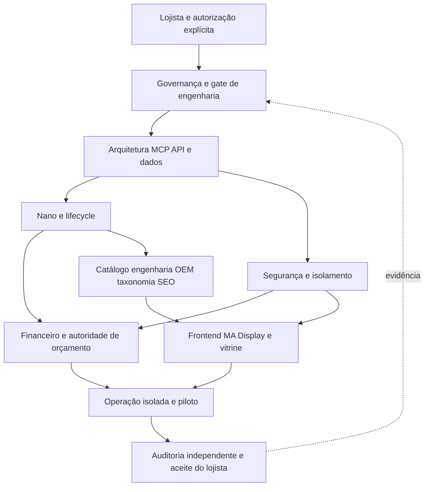

# Matriz Mestra Nano Ecosystem 1.0.0
26/11/2026 — execução incremental autorizada pelo lojista. Não é autorização para compras, envio, alteração fiscal, preços, saldo, publicação de novos itens ou contorno de acesso.
## Modelo mental

Feedback Radar/Analytics é entrada de nova revisão, não dependência circular de execução. Modelos lógicos e métricas em `supabase/functions/_shared/nano_lifecycle/matriz_mestra.ts`. Reusar banco e pipeline existente; não criar tabelas redundantes. O mapa lógico representa dependências para aceite integrado, não impede desenvolvimento paralelo nem pré-compra sem SKU existente: consulta comercial prévia é fluxo candidato, não aprovação de aplicação física. Ausência de evidência = pendência, não 100%; índice é fração de gates na revisão, não probabilidade de acerto. Dashboard futuro deve mostrar numerador/denominador, data, referência e revisão; dados indisponíveis = não medido. Nenhum agente pode declarar sua própria aprovação. Separação real de privilégios e adaptador de evidências ainda pendentes.
## Ordem executiva e aceites
1. Vitrine: corrigir falha de regressão CI mantendo publicação explícita e produto ativo. Homologar filtros, busca por código, links por aplicação, mobile. Não alterar layout aprovado no PR #506. 
2. SEO: adaptar rota SSR por slug de aplicação, canonical/sitemap e segurança sem preço; auditar versão implantada e domínio.
3. Identidade/Lifecycle: reconciliação por loja+ID Bling+SKU, checkpoint/outbox, consumidor persistente e testes concorrentes. Só então ativar para novos produtos, sem backlog em massa.
4. Engenharia/taxonomia: mapeamento por fato e fonte, ano/motor/mercado, OEM por aplicação, fabricantes distintos de marcas; nova raiz proposta e sem duplicidade.
5. Visual Studio e dashboards: renderização tipada e métricas reais; preview ERP sem escrita até aprovação do campo e readback.
6. Commercial/Supplier/Radar: fila privada, sessão dedicada e permissão por portal, cotação e proposta como minutas, sem compra; validar condições e orçamento.
7. Analytics e auditoria: Search Console e eventos comprovados, rollback, gates independentes, homologação 1/10/20/100 SKUs e ampliação conforme resultados. 
## Referências locais (não substituídas)
- nano-lifecycle-20261126.md
- nano-lifecycle-projecoes-nos-20261126.md
- nano-commercial-intelligence-20261126.md
- nano-visual-studio-distribuidores-20261126.md
- nano-supplier-intelligence-rmp-radar-20261126.md
- nano-vitrine-enriquecida-20261126.md
- multiagente-arquitetura.md; ../ordem-mestra/05-contratos-ferramentas.md
## Limites
Contratos puros e testes desta etapa não são dashboard integrado, worker implantado ou auditor independente em produção. Não usar credenciais compartilhadas para aprovação. Toda implantação precisa de CI verde, verificação visual e leitura de retorno, rollback e preservação da produção. 

## Anexo — mapa integrado de qualidade de engenharia e MA Display
26/11/2026. Complementa, não substitui, a ordem executiva, contratos e limites acima. Controle documental; não habilita produção.
### Mapa de dependências para aceite

### Regra de qualidade 1,00
Para cada revisão e bloco, registrar identificador do gate, SHA, ambiente, método, numerador, denominador, artefato, resultado, data e responsável pela revisão. Índice de CI = aprovações / jobs aplicáveis; ignorados só excluídos com justificativa. Índice de aceite integrado = gates obrigatórios satisfeitos / gates obrigatórios previamente definidos. Pendência, ausência de evidência, falha ou não medido não equivalem a aprovação. Não reduzir o denominador para atingir a meta; não usar média para compensar falha crítica. Gate de liberação exige 1,00 em cada bloco obrigatório, sem falhas críticas, evidência visual do mesmo SHA e revisão independente. A meta não é probabilidade nem garantia absoluta. O executor não declara parecer independente próprio.
### Critérios por bloco
| Bloco | Evidências obrigatórias |
|---|---|
| Governança | Matriz rastreável; escopos, autoridades, autorização, revisão e limites explícitos |
| Arquitetura | Contratos API/MCP, schema e rollback testados; sem duplicar autoridade |
| Nano | Ciclo de vida, idempotência, concorrência, filas, isolamento, persistência e recuperação |
| Segurança | Testes negativos, RLS, menor privilégio, ausência de bypass, proteção de caminhos legados |
| Financeiro | Reservas e confirmações concorrentes, autoridade administrativa, competência original, imutabilidade, histórico e revisão independente |
| MA Display | Referência aprovada e inventário de logos, ícones, fontes, tokens, layouts e película; testes da implementação e capturas do mesmo SHA |
| Catálogo | Fonte por fato, OEM e SKU homologados, ano/motor/mercado, marcas distintas, imagens fiéis, SEO, sem preços não autorizados |
| Operação | E2E com dados sintéticos, falhas/reversão, latência medida contra critérios acordados, piloto escalonado 1/10/20/100 somente com autorização |
| Aceite | Relatório consolidado, auditor distinto do executor, aprovação visual do lojista, plano de reversão e autorização específica antes de publicação |
### Gate visual separado do funcional
- Preservar geometria MA e tipografia aprovada; não inventar substitutos. Manter temas e identidade Mobis (grafite #1F2327, vermelho oficial, película, fundo branco para fotos de produtos). Confirmar tokens exatos com a referência aprovada, não inferir valores faltantes.
- Inventariar ícones de navegação, categorias, veículos e peças; usar referências reais/licenciadas e registrar origem. Não confundir atalhos ilustrativos com evidência de aplicação. Não considerar CSS prismático equivalente à biblioteca completa de ícones e alfabeto.
- Comparar início, Nano, catálogo, vitrine e ficha com referência aprovada; validar 360/390/412/1280 px, contraste, acessibilidade, navegação, ausência de overflow, não regressão de filtros e escopo por loja. Registrar capturas e aceite visual humano; não substituir por CI funcional verde.
- Integrar seletivamente a branch visual, preservar alterações funcionais divergentes de LojaMobisNova.tsx. Não fazer merge na main nem deploy por este documento.
### Baseline verificado
- PR #507, SHA c55661c8615a70530233bb71d8437beb7aa5b339: 86 commits, 145 arquivos, 14/14 jobs aplicáveis aprovados, um job de publicação ignorado, draft e sem merge. Autoridade administrativa em minuta CI; não é atribuição real de papel.
- PR #506, SHA 232c42eb99a3a20eca62ef499c8458925d126ca0: 5 commits, 10 arquivos, 11/11 jobs aplicáveis aprovados, um ignorado, draft e sem merge. Camada Prismatic Pro e atalhos ilustrativos; inventário completo e aceite integrado pendentes.
- Bloqueio anterior da ferramenta impediu a integração visual; não houve commit dessa tentativa. Não contornar bloqueio. Integração requer execução permitida e nova homologação.
### Ordem imediata
1. Consolidar documentação (este anexo), homologar a revisão documental.
2. Integrar visual em ambiente permitido, preservar contratos funcionais; exigir capturas novas e revisão MA Display.
3. Retomar competência retroativa, imutabilidade, cascatas e caminhos legados com gates incrementais.
4. Obter parecer independente, demonstrar E2E isolado e consolidar demais dependências da ordem executiva original. Não confundir fechamento do bloco financeiro com conclusão do ecossistema.
5. Submeter relatório e aceite visual/operacional ao lojista; produção exige autorização própria.
