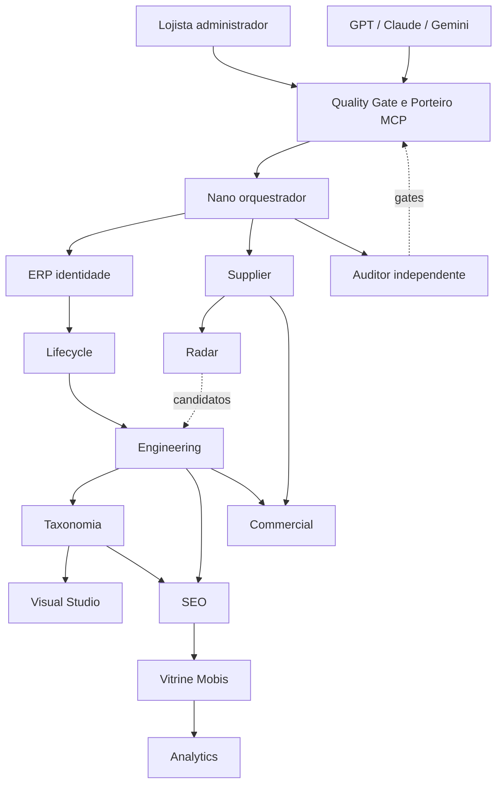
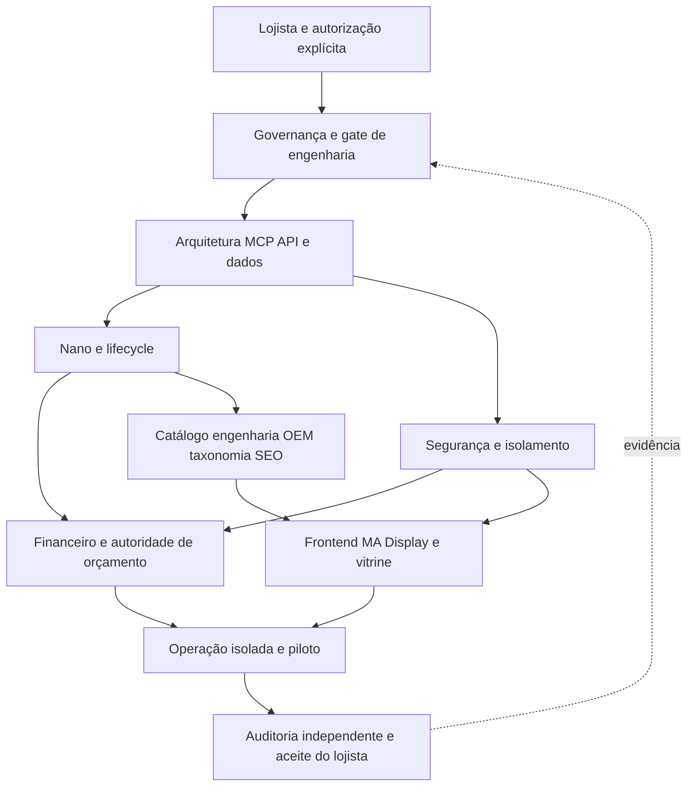

# Matriz Mestra Nano Ecosystem 1.0.0
26/11/2026 — execução incremental autorizada pelo lojista. Não é autorização para compras, envio, alteração fiscal, preços, saldo, publicação de novos itens ou contorno de acesso.
## Modelo mental

Feedback Radar/Analytics é entrada de nova revisão, não dependência circular de execução. Modelos lógicos e métricas em `supabase/functions/_shared/nano_lifecycle/matriz_mestra.ts`. Reusar banco e pipeline existente; não criar tabelas redundantes. O mapa lógico representa dependências para aceite integrado, não impede desenvolvimento paralelo nem pré-compra sem SKU existente: consulta comercial prévia é fluxo candidato, não aprovação de aplicação física. Ausência de evidência = pendência, não 100%; índice é fração de gates na revisão, não probabilidade de acerto. Dashboard futuro deve mostrar numerador/denominador, data, referência e revisão; dados indisponíveis = não medido. Nenhum agente pode declarar sua própria aprovação. Separação real de privilégios e adaptador de evidências ainda pendentes.
## Ordem executiva e aceites
1. Vitrine: corrigir falha de regressão CI mantendo publicação explícita e produto ativo. Homologar filtros, busca por código, links por aplicação, mobile. Não alterar layout aprovado no PR #506. 
2. SEO: adaptar rota SSR por slug de aplicação, canonical/sitemap e segurança sem preço; auditar versão implantada e domínio.
3. Identidade/Lifecycle: reconciliação por loja+ID Bling+SKU, checkpoint/outbox, consumidor persistente e testes concorrentes. Só então ativar para novos produtos, sem backlog em massa.
4. Engenharia/taxonomia: mapeamento por fato e fonte, ano/motor/mercado, OEM por aplicação, fabricantes distintos de marcas; nova raiz proposta e sem duplicidade.
5. Visual Studio e dashboards: renderização tipada e métricas reais; preview ERP sem escrita até aprovação do campo e readback.
6. Commercial/Supplier/Radar: fila privada, sessão dedicada e permissão por portal, cotação e proposta como minutas, sem compra; validar condições e orçamento.
7. Analytics e auditoria: Search Console e eventos comprovados, rollback, gates independentes, homologação 1/10/20/100 SKUs e ampliação conforme resultados. 
## Referências locais (não substituídas)
- nano-lifecycle-20261126.md
- nano-lifecycle-projecoes-nos-20261126.md
- nano-commercial-intelligence-20261126.md
- nano-visual-studio-distribuidores-20261126.md
- nano-supplier-intelligence-rmp-radar-20261126.md
- nano-vitrine-enriquecida-20261126.md
- multiagente-arquitetura.md; ../ordem-mestra/05-contratos-ferramentas.md
## Limites
Contratos puros e testes desta etapa não são dashboard integrado, worker implantado ou auditor independente em produção. Não usar credenciais compartilhadas para aprovação. Toda implantação precisa de CI verde, verificação visual e leitura de retorno, rollback e preservação da produção. 

## Anexo — mapa integrado de qualidade de engenharia e MA Display
26/11/2026. Complementa, não substitui, a ordem executiva, contratos e limites acima. Controle documental; não habilita produção.
### Mapa de dependências para aceite

### Regra de qualidade 1,00
Para cada revisão e bloco, registrar identificador do gate, SHA, ambiente, método, numerador, denominador, artefato, resultado, data e responsável pela revisão. Índice de CI = aprovações / jobs aplicáveis; ignorados só excluídos com justificativa. Índice de aceite integrado = gates obrigatórios satisfeitos / gates obrigatórios previamente definidos. Pendência, ausência de evidência, falha ou não medido não equivalem a aprovação. Não reduzir o denominador para atingir a meta; não usar média para compensar falha crítica. Gate de liberação exige 1,00 em cada bloco obrigatório, sem falhas críticas, evidência visual do mesmo SHA e revisão independente. A meta não é probabilidade nem garantia absoluta. O executor não declara parecer independente próprio.
### Critérios por bloco
| Bloco | Evidências obrigatórias |
|---|---|
| Governança | Matriz rastreável; escopos, autoridades, autorização, revisão e limites explícitos |
| Arquitetura | Contratos API/MCP, schema e rollback testados; sem duplicar autoridade |
| Nano | Ciclo de vida, idempotência, concorrência, filas, isolamento, persistência e recuperação |
| Segurança | Testes negativos, RLS, menor privilégio, ausência de bypass, proteção de caminhos legados |
| Financeiro | Reservas e confirmações concorrentes, autoridade administrativa, competência original, imutabilidade, histórico e revisão independente |
| MA Display | Referência aprovada e inventário de logos, ícones, fontes, tokens, layouts e película; testes da implementação e capturas do mesmo SHA |
| Catálogo | Fonte por fato, OEM e SKU homologados, ano/motor/mercado, marcas distintas, imagens fiéis, SEO, sem preços não autorizados |
| Operação | E2E com dados sintéticos, falhas/reversão, latência medida contra critérios acordados, piloto escalonado 1/10/20/100 somente com autorização |
| Aceite | Relatório consolidado, auditor distinto do executor, aprovação visual do lojista, plano de reversão e autorização específica antes de publicação |
### Gate visual separado do funcional
- Preservar geometria MA e tipografia aprovada; não inventar substitutos. Manter temas e identidade Mobis (grafite #1F2327, vermelho oficial, película, fundo branco para fotos de produtos). Confirmar tokens exatos com a referência aprovada, não inferir valores faltantes.
- Inventariar ícones de navegação, categorias, veículos e peças; usar referências reais/licenciadas e registrar origem. Não confundir atalhos ilustrativos com evidência de aplicação. Não considerar CSS prismático equivalente à biblioteca completa de ícones e alfabeto.
- Comparar início, Nano, catálogo, vitrine e ficha com referência aprovada; validar 360/390/412/1280 px, contraste, acessibilidade, navegação, ausência de overflow, não regressão de filtros e escopo por loja. Registrar capturas e aceite visual humano; não substituir por CI funcional verde.
- Integrar seletivamente a branch visual, preservar alterações funcionais divergentes de LojaMobisNova.tsx. Não fazer merge na main nem deploy por este documento.
### Baseline verificado
- PR #507, SHA c55661c8615a70530233bb71d8437beb7aa5b339: 86 commits, 145 arquivos, 14/14 jobs aplicáveis aprovados, um job de publicação ignorado, draft e sem merge. Autoridade administrativa em minuta CI; não é atribuição real de papel.
- PR #506, SHA 232c42eb99a3a20eca62ef499c8458925d126ca0: 5 commits, 10 arquivos, 11/11 jobs aplicáveis aprovados, um ignorado, draft e sem merge. Camada Prismatic Pro e atalhos ilustrativos; inventário completo e aceite integrado pendentes.
- Bloqueio anterior da ferramenta impediu a integração visual; não houve commit dessa tentativa. Não contornar bloqueio. Integração requer execução permitida e nova homologação.
### Ordem imediata
1. Consolidar documentação (este anexo), homologar a revisão documental.
2. Integrar visual em ambiente permitido, preservar contratos funcionais; exigir capturas novas e revisão MA Display.
3. Retomar competência retroativa, imutabilidade, cascatas e caminhos legados com gates incrementais.
4. Obter parecer independente, demonstrar E2E isolado e consolidar demais dependências da ordem executiva original. Não confundir fechamento do bloco financeiro com conclusão do ecossistema.
5. Submeter relatório e aceite visual/operacional ao lojista; produção exige autorização própria.

## Complemento de paleta MA Display — 26/11/2026
Correção expressamente solicitada pelo lojista: incluir aço escovado e azul na paleta de temas, preservando todos os tokens originais Mobis M-STYLE V3 (grafite #1F2327, vermelho #E2181A, cinza #BFC3C7, aço #A6A6A6, branco #FFFFFF e gelo #EAF2F6). Aço escovado é acabamento/textura metálica sobre base #A6A6A6, não substituição do aço sólido; azul auxiliar tecnológico #0D47A1 é referência proposta para amostra e aceite visual, não alegação de token original V3. Uso em superfícies, ícones, contornos e película; preservar legibilidade, temas, alto contraste, geometria MA e lettering original. Fotografias de produto permanecem fiéis sobre fundo branco; não recolorir logos nem imagens. Exigir amostra e captura integrada do mesmo SHA, testes de contraste e aprovação visual. Atualização apenas documental, sem alterar CSS, código, dados, produção, preço, orçamento, ERP ou publicar paleta. Integração visual segue pendente e sujeita a execução permitida. Base #507 commit 87 e32092931317524f510ef71cb15cfdc7ea33d934: 14/14 jobs aplicáveis aprovados; publicação ignorada.

## Anexo — linguagem universal de ícones e roteamento semântico (27/11/2026)
Diretriz do lojista: todos os ícones presentes e futuros obedecem ao padrão visual universal MA Display e representam nós de um mapa semântico comum ao frontend, catálogo, mapas mentais e agentes. Não substituir o modelo de dados por reconhecimento visual.
- Separar identidade semântica estável (node_id, node_type, icon_id, versão), apresentação (SVG de referência, paleta, acabamento, estado acessível) e relações tipadas entre nós (origem, destino, tipo de relação, escopo loja, fonte e estado de homologação). Estes nomes são proposta de contrato documental, não schema implantado. Reutilizar identificadores e contratos existentes quando disponíveis; não duplicar autoridade.
- Montadora, modelo, geração, ano, mercado, motor, tração, combustível/propulsão, sistema, componente, OEM, SKU e aplicação são dimensões distintas. Hyundai HR e Kia Bongo devem ter representações visuais específicas por modelo e geração quando a referência homologada existir. Baú/carroceria não identifica motor nem tração. 4x2 não implica eixo traseiro motriz; distinguir eixo quando comprovado. Diferenciar diesel, gasolina, etanol, flex, elétrico e híbrido; subdividir híbridos quando houver documentação. Não inferir especificações por foto, nome, cor ou ícone.
- Rota ilustrativa: montadora > veículo > configuração técnica > sistema > componente > identidade OEM/SKU > aplicação homologada; o grafo admite relações múltiplas e caminhos alternativos comprovados. Porteiro valida escopo, autorização, proveniência, compatibilidade e destino antes de qualquer ação. Ícone é orientação, nunca autorização nem prova de aplicação. Ausência de fato = desconhecido/pendente, sem inventar rota.
- Estilo: contorno técnico automotivo uniforme, fundo branco nas referências de produtos, variantes grafite, vermelho, azul, branco, gelo e aço escovado; geometria constante em variantes. Preservar logos oficiais e lettering originais, não tratar imagens geradas de montadoras ou veículos como ativos oficiais ou fotografias de referência. Usar fontes e ativos autorizados. Cabeçote permanece componente da categoria motor.
- Inventário futuro: cada ícone exige chave única, rótulo acessível, conceito, referência, versão, variantes, vínculos permitidos e teste de ausência/colisão. Novo ícone não cria categoria nem relação automaticamente; extensão passa por revisão, compatibilidade de versões, teste de renderização responsiva, contraste e aprovação do lojista. Manter fallback explícito sem falsear identidade.
- Aceite 1,00 por bloco: cobertura integral do inventário obrigatório previamente definido, zero colisões de IDs, zero rotas indevidas nos cenários de teste, referências e relações rastreáveis, contraste e capturas aprovadas, auditoria independente. Sem evidência não há homologação. A meta é fração de gates satisfeitos, não garantia absoluta.
- Base #507 commit 88 e435d1c9be13005f425c61037935d93bda01974a: 14/14 jobs aplicáveis aprovados; publicação ignorada. Esta atualização é exclusivamente documental; não altera frontend, taxonomia, rotas reais, dados, ERP, preços, orçamento ou produção. Integração frontend anteriormente bloqueada continua pendente; não contornar restrição. Amostras visuais da conversa são conceituais e ainda não constituem biblioteca vetorial homologada.

## Checkpoint 90 — continuidade técnica do portfólio
Base 3208ce1309c2120eb07e97a80292c0e6440999f2, commit 89: 14/14 jobs aplicáveis aprovados; publicação ignorada. Retomar engenharia no módulo existente de projeções, sem consultas ao catálogo operacional. Introduz resolução visual pura e testes sintéticos por nó existente, com níveis compacto/3D/EPC e expansão de tecnologias; preserva identidade e rejeita colisão, falta de evidência/direitos ou mistura de lojas. Não é biblioteca de imagens pronta, integração frontend, cadastro ou indexação Google. Próximo gate: homologar CI, revisar ativos e integração autorizada, manter competência retroativa e imutabilidade financeira pendentes. Não confundir ensaios visuais com código integrado.

## Checkpoint 91 — registro universal versionado
Base 508c0f6c3dc99a9a24c79ce11630bd18ea638b52 (90): 14/14 jobs aplicáveis aprovados, publicação ignorada. Implementa manifesto puro de ativos por nó existente, identidade estável dentro do manifesto, revisão vigente explícita, histórico/revogação, fonte, hash declarado e acessibilidade. Testes VIS-91-01 a 05. Não cria taxonomia, não escreve no ERP, não obtém acervo externo, não verifica bytes/licença real nem persiste histórico. Próximo gate: homologar CI e definir projeção de rastreabilidade visual por montadora/modelo/geração/mercado usando fatos aprovados; depois integrar acervo e frontend em execução permitida, com aceite visual. Financeiro retroativo/imutabilidade e auditoria independente continuam pendentes. Bloqueio anterior da integração frontend não deve ser contornado.

## Checkpoint 92 — rastreabilidade visual contextual
Base be0b07f3bd50bc6fada1d1e1d2901cd0d06992cb (91): PR #507 draft, 14/14 jobs aplicáveis aprovados; publicar-homologacao ignorado (sem deploy). O incremento 92 acrescenta projeção pura por aplicação existente, loja, produto, montadora, modelo, geração e mercado exatos; vínculo aprovado por nó, nível e revisão vigente. Sem vínculo aprovado retorna texto; sem contexto aprovado não publica projeção; conflito de identidade/escopo falha fechado. VIS-92-01 a 06, fixtures sintéticas multicontinentes, elétrico/híbrido. Não altera filtro público BR vigente, taxonomia, frontend, dados, preços, ERP ou produção; nenhuma consulta operacional. Adaptador autorizado ainda deve validar evidência, mercado canônico, licença, bytes e unicidade global; contrato não constitui acervo real, publicação ou aprovação visual. CI 92 pendente. Próximo gate: homologar CI, consolidar biblioteca e direitos, estrutura de página universal, integração visual somente em execução permitida; controles financeiros retroativos/imutabilidade e auditoria independente permanecem obrigatórios.

## Checkpoint 93 — consolidação lógica da biblioteca universal
Base 9465d41d589be6ecd7f81d94c68e834dafdbca2f (92): 14/14 jobs aplicáveis aprovados, publicar-homologacao ignorado; VIS-92-01 a 06 aprovados nos logs de funções. Incremento 93 acrescenta validação pura de transição entre manifestos completos: identidade e metadados históricos imutáveis, próxima revisão sequencial, uma inserção por ícone por transição, revogação definitiva e veto a ativo/digest revogado inclusive alias. Cobertura medida por inventário obrigatório aprovado, não pelos ativos disponíveis; ausência é pendência, denominador vazio ou duplicado é erro. Níveis compacto/3D/EPC permanecem distintos; EPC só exigível conforme inventário explícito, sem reduzir denominador para aprovação. VIS-93-01 a 07 sintéticos. Não comprova armazenamento imutável, autoridade persistente, concorrência, bytes, licença ou acervo gráfico; adaptador confiável deve carregar snapshot anterior completo/autenticado, garantir CAS/transação e verificar evidências. Sem catálogo operacional, produção, preços, ERP, frontend ou schema. CI 93 pendente. Próximo gate: homologar CI; estruturar padrão universal de página de produto; acervo real e integração frontend permanecem condicionados à execução autorizada. Financeiro retroativo/imutabilidade e auditoria independente continuam obrigatórios.

## Checkpoint 94 — ficha universal e autorização contínua
Base d2b5ca0328f64b389d7e8c7b31e8ef14e953d3a6 (93): 14/14 jobs aplicáveis aprovados; publicação ignorada; VIS-93-01 a 07 aprovados. Implementa projeção pura de ficha individual no mercado público BR, reutilizando elegibilidade, IDs, OEM por aplicação, MPN aprovado, categoria e contexto visual em três níveis. Centraliza veto de leitura de alias revogado no manifesto. VIS-94-01 a 05 sintéticos. Não altera rota, layout, SEO implantado, banco, Bling ou preços. CI pendente.
### Gate transversal de preservação patrimonial
Lojista autorizou continuidade dos incrementos de desenvolvimento sem confirmação a cada commit, em 27/11/2026. Não revoga bloqueios de segurança nem autorização específica de produção/publicação. Antes de aceite integrado, inventariar em baseline versionada os nós e relações (IDs, escopo, fonte, estado), MCPs e ferramentas (contrato, parâmetros, retorno, escopo, permissões), APIs, filas, funções, integrações, dados e histórico. Comparar com candidato; exigir correspondência por identidade e testes de regressão por capacidade homologada, sem deduzir inventário de resultados parciais. Duplicidade/obsolescência exige reconciliação documentada, aliases ou migração reversível, preservação histórica e aprovação de desativação; não excluir nem remapear por aparência. Denominador obrigatório pré-fixado; ausência, conflito ou falta de prova = pendência. Inventário de código em Git é permitido; inventário operacional real, acesso EPC licenciado e revalidação de conexões reais só na fase autorizada. Não declarar gate concluído a partir de documentação. Evidências de rollback, contratos, RLS, auditoria independente e aceite humano para liberação.
Ordem de conclusão gerencial: biblioteca; ficha/taxonomia/SEO; MA Display; três projeções; lifecycle; financeiro; MCPs/legado/Supplier/Radar; E2E/Analytics/auditoria; piloto/implantação. Dependências prevalecem sobre sequência; nenhum avanço por CI pendente. Produção continua fora do escopo atual.

## Checkpoint 95 — três destinos, identidade física única
Base a032dad609ea4ae2e5d9dad2a2defa30c3e4163c (94): 14/14 jobs aplicáveis aprovados, publicação ignorada; VIS-94-01 a 05 aprovados nos logs. Incremento 95 cria despacho puro de projeção por destino no módulo existente: site público usa ficha 94 e publicação explícita; Conecta privado usa identidade física, fatos BR e IDs de pendências; ERP recebe apenas prévia textual dos dois campos existentes, sem mídia legada ou escrita. Reutiliza elegibilidade, valida manifesto e escopo, não confunde candidatos ou mercados externos com aplicações BR. INT-95-01 a 06 sintéticos. Destino escolhido não é autorização; adaptador autenticado deve impor permissões e nunca serializar projeção privada em endpoint público. Nenhum endpoint, frontend, banco, ERP, produção ou SEO implantado foi alterado. Preservar rotas SEO atuais e prova independente; próxima etapa: ponte de evidências para SEO e inventário patrimonial de código, ou controles financeiros/lifecycle executáveis conforme dependências e bloqueios. CI 95 pendente.

## Checkpoint 96 — ponte de evidência técnica para SEO
Base d4b55149e8848de34fc514630fd6394c90f73def (95): 14/14 jobs aplicáveis aprovados; publicação ignorada; INT-95-01 a 06 aprovados. Novo contrato puro reconciliarProvaSeo em nano_lifecycle/seo_evidencia.ts remove prova recebida sem autoridade e só conserva prova explícita de homologação vigente fornecida pelo adaptador confiável, com escopo físico, revisão, aprovação independente, geração/motor/montadora, OEM, texto, fonte forte, período e mercado BR coincidentes; reutiliza validarAplicacao e aplicacaoIndexavel existentes. SEO-96-01 a 05 sintéticos exercitam rota/sitemap existentes, retenção de legado, revogação, conflito, autoaprovação e pai inválido. Procedência conferida não é homologação. Não cria prova persistente, não integra adaptador real nem modifica loja-seo, rota, frontend, banco, preços, ERP ou produção. A aprovação independente e a atualidade precisam de autoridade real e revalidação no consumo; nenhuma autorização de publicação. CI 96 pendente. Próximo gate: inventário patrimonial versionado de código/contratos e financeiro/lifecycle conforme dependências; frontend bloqueado.

## Checkpoint 97 — baseline patrimonial de código
Base 32bb5385547cf4aab816540678624e8c8af07333 (96): 14/14 jobs aplicáveis aprovados; publicação ignorada; SEO-96-01 a 05 aprovados. Inventário real de árvores Git completas, baseline main b8d6b32338fa06da08c9f2d05859d9b4c22519db, candidato 96: 1519 arquivos obrigatórios, 1500 idênticos, 19 alterados pendentes de revisão, 0 ausentes, 129 novos. Presença 1,00 não é homologação funcional. TSV baseline e delta fixados em docs/conector-ia; comparador puro e PAT-97-01 a 05 sintéticos. Nenhuma remoção de arquivo legado encontrada no candidato medido; inventário semântico MCP, APIs, nós, permissões, integrações e dados/histórico operacional e auditoria independente continuam pendentes. Nenhum acesso operacional ou alteração de ERP, preços, frontend, banco ou produção. CI 97 pendente. Próximo gate: inventário semântico dos contratos MCP existentes e regressão dos legados alterados, depois demais pendências financeiras/lifecycle conforme dependências.

## Checkpoint 98 — inventário semântico de MCPs
Base 8e6ff9f56b11e22dfc4cf5967dd7a98a5b2917df (97): 14/14 jobs aplicáveis aprovados, publicação ignorada, PAT-97-01 a 05 aprovados. Inventário real de código: 92 fontes do recorte MCP/Pair/assistente idênticas ao baseline main, 67 IDs centrais (inclui planejadas/desligadas), oito capacidades locais, 22 aliases assistente, 18 Pair (11 sem contrato central). Manifesto versionado, função pura e MCP-98-01 a 05 sintéticos. Sem catálogo concorrente ou alteração das ferramentas existentes. Presença e identidade de fonte não provam operação; lacunas Pair, dependências externas, revisão dos 19 arquivos alterados, nós/integrações reais e auditoria independente pendentes. Sem acesso operacional, escrita ERP, produção, frontend ou preços. CI 98 pendente. Próximo gate: revisão de contratos legados alterados e dependências, controles financeiros/lifecycle conforme Matriz.

## Checkpoints 99–101 — reconciliação de legado e fronteira API/SEO
99: 6fbdefd01e6ff93cf4482bf0c8907b908bc45aea; LEG-99-01 a 05 aprovados, 11 contratos próprios Pair preservados, sem novos escopos. 100: d11dc3a657a45c8300dd0289b8bf82339a39b687; 10/10 workflows e 14/14 jobs aplicáveis aprovados, publicação ignorada, funções 1014 aprovados, 116 ignorados, zero falhas. Revisão preliminar dos 19 arquivos do delta 97 identificou divergência do indicador legado na API pública; 100 passou a devolver indexavel:false, sem mudar SKU, status ou consulta. 101 acrescenta INT-101-01 a 06: inspeção estática das fronteiras API/SEO e integração sintética da autoridade pura, rota e sitemap. CI 101 pendente. Não é teste HTTP real, não carrega prova persistente nem confirma isolamento operacional; consulta pública e SEO ainda possuem critérios diferentes de elegibilidade de consulta, a revisar separadamente. Não alterar preços, estoque, ERP, frontend, banco ou publicar. Próximo gate: CI 101, mapeamento e autenticação da autoridade persistente, consistência da visibilidade de consulta e regressões dos demais arquivos, com auditoria independente. A nota do CI não equivale à homologação integral.

## Checkpoint 102 — integração funcional do gate de consulta pública
Base 0b3f8fbddefaef5b5f7ec81ff3c0386b878a27e8 (101): 10/10 workflows, 14/14 jobs aplicáveis, publicação ignorada; INT-101-01 a 06 aprovados; funções 1020 aprovados, 116 ignorados, zero falhas. Integra API loja-publica e loja-seo à mesma projeção explícita dos campos legados; API usa podeConsultarAplicacao já existente na rota e identidade mínima do pai. Leitura dos campos modelo_id, fonte, coletado_em e nome já utilizados pelo SEO; nenhuma mudança de schema. Registro sem fonte/data válida, contraditório ou pai sem nome passa a negar consulta na API como já ocorre no SEO: impacto no legado incompleto a medir em homologação isolada antes de liberar. Nenhuma expansão de visibilidade, sem prova inferida, SKU/preço/estoque/ERP preservados. INT-102-01 a 04 sintéticos e ligação estática; CI pendente, HTTP real e prova persistente não validados. Inventário de autoridade: migração 20261115000031 registra flag de visibilidade e unicidade por loja, não prova estruturada; porta_auditoria_sql.ts confere procedência histórica/vigente do lifecycle em sessão dedicada, não equivale a homologação técnica independente da aplicação; não conectar credencial pública/service role a essa autoridade. Mapear vínculo exato entre chave lifecycle e aplicação/revisão, decisão independente e revogação antes de adaptar consumo. Restam divergências de apresentação (OEM/texto legado em JSON vs HTML consultivo), a revisar com proteção da identidade e sem publicar. Próximo gate CI 102, contrato de vínculo persistente, regressões legadas, E2E isolado e auditoria independente. Sem deploy/merge/produção.

## Checkpoint 103 — vínculo consultivo da autoridade técnica existente
Base c8142314ecac5f6792f89023dfb97a332195f3bd (102): 10/10 workflows, 14/14 jobs aplicáveis, publicação ignorada, INT-102-01 a 04 aprovados; funções 1024 aprovados, 116 ignorados, zero falhas. Mapeamento no Git: resultados_engenharia (resultado-engenharia-MINUTA) possui homologada=false obrigatório, autoria/geração/revisão e hashes; conferencias_gate (conferencia-gate-MINUTA) registra snapshot histórico imutável, leitura, hash e auditor, homologada=false; porta_auditoria_sql.ts já dispõe de pré-gate consistente em sessão dedicada. São minutas CI e não se presume implantação. Nenhum desses registros constitui decisão independente de homologação de aplicação. Incremento 103 integra a função conferirVinculoAplicacaoSql à mesma porta e pré-gate existentes, sem autoridade concorrente, valida identidade loja/produto/SKU/revisão/chave e igualdade exata do fato inclusive emissão/mercado/tipo de ano; captura entradas antes de awaits, retorna referência de leitura/hash sem homologar. Alvo precisa vir de autoridade de catálogo confiável: a função não prova por si só que o ID de aplicação está persistido com aquele fato; associação real, aprovação/revogação independente, sessão operacional e revalidação atômica permanecem pendentes. Não emitir prova SEO, não conectar credencial pública, não escrever em banco. AUT-103-01 a 05 com sessão sintética; CI 103 pendente. Próximo gate: mapear autoridade de catálogo e vínculo persistente da decisão, preservar histórico/revogação, testar regressões legadas e auditoria independente. Sem produção, deploy, ERP, preço ou alteração de schema.

## Checkpoint 104 — reconciliação conservadora das decisões legadas
Base 9b505c5d184cd0f2c664589cdab77ff8b9e3826f (103): 10/10 workflows, 14/14 jobs aplicáveis, publicação ignorada; AUT-103-01 a 05 aprovados, funções 1029 aprovados, 116 ignorados, zero falhas. Autoridade de catálogo mapeada em 20261014000002_taxonomia_codigos_autopecas.sql (produto_aplicacoes, escopo loja/produto/ID), 20261123000001_enriquecimento_decidir.sql (aplicacao_decidir, antes/depois, status e ator informado pelo servidor) e 20261013000005_restricoes_auditoria.sql (auditoria append-only para update/delete, RLS). Riscos a revisar: leitura antes do update sem lock explícito, p_user recebido do servidor, constraint pagina_indexavel exige aprovado e pode impedir rejeição se flag estiver true; conferir caminhos efetivos da rota humana, grants, TRUNCATE e concorrência antes de corrigir, sem alterar produção. Incremento 104: reconciliador puro do histórico legado em snapshot consistente, exige escopo exato, cadeia antes/depois, bigint textual, ordem temporal não ambígua, ator e snapshot atual idêntico; rejeição posterior veta aprovação antiga e edição posterior invalida decisão. CAT-104-01 a 05 sintéticos, CI pendente. Não comprova completude do histórico, autenticação do ator, independência, decisão vinculada a hash/revisão ou revogação técnica; não emite prova SEO. Adaptador confiável, revisão atômica e vínculo persistente com o pré-gate 103 permanecem pendentes. Não cria tabela concorrente, não escreve no banco, ERP, preço ou produção. Próximo gate: CI 104; mapear caminhos de decisão real e aplicar proteção de concorrência/revogação em minuta/teste isolado, sem ampliar escopos; auditoria independente e regressões patrimoniais.

## Checkpoint 105 — decisão e revogação atômicas em banco descartável
Base 44ee5f052850347d479c46308b8e17678a9dfb50 (104): 10/10 workflows, 14/14 jobs aplicáveis, publicação ignorada; CAT-104-01 a 05 aprovados; funções 1034 aprovados, 116 ignorados, zero falhas. Inventário adicional: rodar_local.sh percorre migrations/*.sql inclusive enriquecimento_decidir_REVERSAO.sql, que remove RPCs; conector-aprovacoes/acoes.ts não possui despacho explícito dessas funções. Não presumir RPC operacional ou autenticidade de p_user. Incremento 105: minuta somente CI da mesma assinatura aplicacao_decidir, bloqueia linha antes da leitura, captura RETURNING, escopo loja no UPDATE, rejeição remove flag de visibilidade atomicamente; aprovar não restaura flag, auditoria antes/depois na mesma transação e timestamp após lock. Sem nova autoridade, grants existentes service_role apenas, rejeita ator nulo mas não autentica ator; nenhuma ampliação de acesso. CAT-105-01 a 04 SQL sintético e CAT-105-05 duas conexões PostgreSQL reais no runner descartável; workflow explícito, CI pendente. Não alterar migração original/reversão nem executar em Supabase. Reconciliador 104 é conservador: rejeição que muda flag junto ao status será retida até adequar contrato; próximo incremento deve reconhecer exclusivamente essa transição autorizada, validar cadeia e ligação com autoridade real de aplicação/decisão humana, investigar caminhos legados, preservar rastreabilidade e auditoria independente. Sem merge, deploy, ERP, dados reais ou preço.

## Checkpoint 106 — correção da fixture do gate 105 (sem expansão funcional)
Base f3d5492761a9e1807e0d52af5b676c9f4303bb6a: 9/10 workflows aprovados; job funcoes aprovado, banco falhou na inserção da aplicação sintética, constraint aplicacao_aprovada_com_oem (log job 140505055068). A migration 20261014000008_revisoes_supersessoes_bula.sql exige codigo_oem não vazio e montadora_origem_id para status aprovado. Corrigidas as duas fixtures CAT-105 (SQL e concorrência), com marca veicular sintética da própria loja, montadora de origem e OEM explicitamente fictícios. Nenhuma alteração à constraint, implementação, permissões, workflow ou critérios dos testes. CI 106 pendente. Só após homologação retomar integração do reconciliador ao novo controle de revogação. Sem produção, merge, deploy, ERP ou preço.

## Checkpoint 107 — reconciliação da transição atômica de revogação
Base acc74f9fba97d05fb0982c4f71e86ada67d9b615 (106): 10/10 workflows, 14/14 jobs aplicáveis, publicação ignorada; funções 1034 aprovados, 116 ignorados, zero falhas; CAT-105-01 a 05 comprovados no log banco 140508771324, incluindo concorrência real em runner descartável. Integra ao reconciliador 104 o contrato SQL 105: rejeição pode alterar exclusivamente status e pagina_indexavel para false; aprovação preserva flag anterior, não restaura indexação; flags ausentes/ilegíveis e estado prévio incoerente retidos. Mantém igualdade integral dos demais campos, cadeia antes/depois, comparação com snapshot atual e ausência de prova SEO. CAT-107-01 a 05 sintéticos, CI pendente. Aprovação repetida de registro já indexável permanece decisão legada, não homologação técnica. O contrato não valida completude, identidade humana, associação a hash/revisão ou leitura persistente em sessão real; próxima etapa integrar readback do PostgreSQL descartável ao reconciliador, revisar autoridade humana e preservar bloqueios. Sem migração, ERP, produção, deploy, preço ou merge.

## Checkpoint 108 — readback PostgreSQL/TypeScript da decisão de catálogo
Base 1562b42a1bf38d0e111464bbc3f43a26e167f903 (107): 10/10 workflows, 14/14 jobs aplicáveis, publicação ignorada; funções 1039 aprovados, 116 ignorados, zero falhas; CAT-107-01 a 05 e CAT-105-01 a 05 confirmados. Integração E2E no runner PostgreSQL descartável: executa a RPC existente na minuta 105 com service_role, lê estado e histórico em uma única instrução SELECT (snapshot MVCC, bigint convertido em texto antes do JSON, sem limite), chama reconciliador 107 com registros retornados. CAT-108-01 a 05: flag sem histórico, rejeição real, reaprovação sem republicação/prova, escopo/histórico desatualizado, edição posterior. Teste usa fixture isolada e consulta administrativa exclusiva do CI, não é adaptador autenticado de produção e não demonstra completude contra adulteração/truncamento arbitrário, identidade humana ou decisão independente vinculada ao hash. CI pendente. Próximo gate: homologar E2E, identificar caminho efetivo da decisão humana e construir leitura restrita pela autoridade existente, sem contornar RLS ou credenciais públicas; vincular revisão e prova técnica apenas após autorização independente. Sem alteração em migrações, produção, ERP, preços ou merge.

## Checkpoint 109 — leitura restrita da decisão de catálogo
Base c3d13c3fd8f13fd58bad71280ec76205b7a6d88b (108): 10/10 workflows, 14/14 jobs aplicáveis; funções 1039 aprovados, 116 ignorados, zero falhas; CAT-108-01 a 05 confirmados no banco 140521621531. Minuta CI exclusiva em schema interno: reutiliza nano_lifecycle_verificador_autorizado e session_user, leitura com papel NOLOGIN sem DML/BYPASSRLS, RLS restrita à loja e tabela, snapshot STABLE, chave loja/produto/aplicação e bigint textual; nenhum grant a público, service_role ou produtor. Papel de leitura não é autoridade de aprovação. CAT-109-01 a 06 usam login real sintético de auditor, com comparação de readback, escopos divergentes, privilégios, revogação e edição posterior. CI pendente. Não prova identidade/autorização do ator humano da decisão legada, vínculo ao hash ou completude contra adulteração administrativa; não concede prova SEO. Próximos gates: CI 109, adaptar leitura parametrizada servidor e identificar caminho humano real; proteção de auditoria legada e vinculação persistente só com autoridade independente. Sem migração, produção, ERP, preços, merge ou deploy.

## Checkpoint 110 — porta parametrizada para reconciliação consultiva
Base 72606a9e7af4676611955e456ec18a1c147b78d2 (109): 10/10 workflows, 14/14 jobs aplicáveis, publicação ignorada; funções 1039 aprovados, 116 ignorados, zero falhas; CAT-109-01 a 06 confirmados no banco 140526472041. Porta servidor consulta RPC 109 em instrução única parametrizada, confere session_user, valida envelope e escopo capturado antes de await, reutiliza reconciliador; não emite prova SEO. CAT-110-01 a 05 unitários e CAT-110-06 a 07 com psql bind/login sintético real no CI descartável. Driver do ensaio abre conexão por consulta (uma única instrução de leitura), não é provisionamento operacional. CI pendente. Ainda não prova associação persistida entre revisão técnica e aplicação, identidade humana, integridade absoluta do histórico nem atomicidade entre pré-gate técnico e leitura de catálogo; não combinar resultados de snapshots diferentes como autorização. Próximo gate: proteger histórico legado e mapear autoridade humana efetiva; avaliar união consistente com pré-gate e vínculo técnico sem inferir campos ausentes. Sem migração, produção, ERP, preços, merge ou deploy.

## Checkpoint 111 — preservação do histórico legado (CI descartável)
Base 4b7080dc9eee4d067314eb66e0554c7a03cd7db9 (110): 10/10 workflows, 14/14 jobs aplicáveis; publicação ignorada; funções 1044 aprovados, 116 ignorados, zero falhas; CAT-110-01 a 07 confirmados. Auditoria original possui trigger BEFORE UPDATE/DELETE, não ALWAYS e sem TRUNCATE. Minuta 111 reutiliza private.auditoria_imutavel, habilita trigger existente ALWAYS e acrescenta BEFORE TRUNCATE ALWAYS; não altera grants, RLS, escritores, dados ou esquema operacional. CAT-111-01 a 05 verificam DML destrutivo em modo normal/replica, preservação integral, nova decisão legítima sem mascarar quebra histórica, e regressão de outro escritor legado (restricoes_loja). CI pendente. Limites: não protege contra DDL deliberado por administrador, INSERT forjado por papel privilegiado, omissão anterior ao controle, nem comprova autoria humana. Próximos gates: CI 111, inventariar escritores/rota humana e autoridade efetiva, testar origem autenticada e vínculo de revisão com fato técnico; não confundir consulta em snapshots distintos com autorização. Sem migração, produção, ERP, preços, merge ou deploy.

## Checkpoint 112 — caracterização da autoridade efetiva legada (CI descartável)
Base c3a2d39561f4a1603b2df92df8e6d501fcc1745c (111): 10/10 workflows, 14/14 jobs aplicáveis, publicação ignorada; funções 1044 aprovados, 116 ignorados, zero falhas. CAT-111-01 a 05 confirmados no job 140535390876. CAT-112-01 a 04 caracterizam fronteira EXECUTE, contraprova de UUID inexistente em auth.users aceito pelo serviço (sem homologação), escrita direta da aplicação pelo service_role detectada na reconciliação e inventário parcial de ACL/funções. Testes de caracterização não significam correção do risco. CI 112 pendente. Referências de origem: migrations 20261123000001_enriquecimento_decidir.sql, 20261014000002_taxonomia_codigos_autopecas.sql, 20261013000005_restricoes_auditoria.sql. Rota humana HTTP e autoridade de sessão ainda não comprovadas; busca textual não cobre SQL dinâmico, chamadas externas ou todos os escritores. Próximo gate: rastrear rota efetiva autenticada, testar autorização de loja e ator derivado da sessão sem confiar em UUID do cliente; avaliar vínculo de fato técnico com revisão e snapshot consistente. Sem alteração de grants, schema, produção, ERP, preços, merge ou deploy.

## Checkpoint 113 — correção do ensaio de autoridade 112
Base c8edab51f5b99f8e850cbb43ef43b32774090127 (112): CI falhou no job banco 140548808142, execução 46011767990, ao consultar auth.users (relação ausente no stub descartável). CAT-112-01 passou; CAT-112-02 a 04 ainda sem resultado conclusivo. O stub supabase/tests/stub_supabase.sql implementa auth.uid() por claims sintéticos, não cadastro de usuários. Corrige CAT-112-02 para verificar auth.uid() IS NULL na mesma transação e papel service_role da chamada, com claims vazias. Mantém as asserções de evento, estado legado e ausência de prova; não afirma que o UUID inexiste no Auth real. Sem remoção de controles, sem alteração de grants ou schema. CI 113 pendente. Gate de autoridade humana e vínculo técnico permanece bloqueado até homologação; não há nova rota operacional. Sem produção, ERP, preços, merge, publicação ou deploy.

## Checkpoint 114 — autoridade existente de sessão e mapa da rota humana
Base 390024581757addb975c817a157587582fdb85e1 (113): 10/10 workflows, 14/14 jobs aplicáveis, publicação ignorada; CAT-112-01 a 04 confirmados no job 140549802607, incluindo ausência de auth.uid(), escrita direta e ACL efetiva. A rota painel/src/paginas/Fila.tsx chama assistente para produto_enriquecimento e imagens; assistente/index.ts usa auth.getUser e podeDecidir (pode_administrar_loja), mas não trata aplicação veicular. Migration 20261123000001_enriquecimento_decidir.sql cita conector-aprovacoes; no HEAD, conector-aprovacoes/index.ts chama autenticar (membro lojista/editor) e acaoAprovacoes (ações de propostas, sem caso aplicacao_decidir). Não presumir rota implantada ou proteção equivalente. CAT-114-01 a 05 exercitam gate existente de administração com claims sintéticos do stub, papel, loja, ausência de ator, metadata editável, MFA insuficiente, revogação e ausência de escrita/prova; não testam assinatura JWT, sessão real, corrida de revogação ou fluxo HTTP. Mantém política existente, sem alterar ACL nem adicionar RPC. CI 114 pendente. Próximo gate: desenhar autoridade exclusiva da decisão vinculada ao ator e revisão persistida, em minuta descartável, sem confiar em corpo HTTP nem compartilhar service_role como prova; não expor rota antes de validação independente. Sem migração, produção, ERP, preços, merge, publicação ou deploy.

## Checkpoint 115 — contrato candidato da autoridade exclusiva de decisão de catálogo
Base de trabalho de12c7addbf961e85645cf81eb1527c7aa29c255 (114): 10/10 workflows, 14/14 jobs aplicáveis aprovados; publicação ignorada (job 140553327836). CAT-114-01 a 05 confirmados no job banco 140553033878, execução 46013021092. Testes de sessão são sintéticos; não demonstram JWT real, atomicidade de revogação ou fluxo HTTP. Nenhum parecer independente para 114 encontrado nas revisões do PR. Este incremento é desenho documental, não implantação da autoridade nem homologação. Não modifica migrações, grants, RPC, consumidores, produção, preços, ERP, main ou publicação.
### Decisão de arquitetura candidata (não contrato implantado)
- Preservar public.produto_aplicacoes e public.auditoria como projeção/registro existentes, a reconciliação 107–110 como leitura consultiva e a minuta 111 de imutabilidade. Não criar segundo cadastro, nova taxonomia ou segundo escritor de status. A assinatura legada public.aplicacao_decidir(loja,aplicacao,user,decisao) da minuta 105 não prova o autor humano; não basta acrescentar wrapper chamando-a enquanto outro caminho puder gravar decisão. Não revogar permissões operacionais antes de inventário integral, testes de compatibilidade e revisão independente.
- Candidata: uma única fronteira transacional de decisão, derivando ator de auth.uid() da sessão autenticada, com política existente public.pode_administrar_loja e revisão da identidade autenticada/credenciais no servidor; não aceitar user_id, papel, produtor, verificador, hash ou estado de homologação como prova fornecida pelo cliente. Entrada de intenção deve limitar-se a escopo loja/produto/aplicação, decisão, identificador opaco da revisão esperada e chave de idempotência. Não conceder EXECUTE nem habilitar rota HTTP nesta revisão. A separação entre sessão humana e papel NOLOGIN escritor precisa ser demonstrada no ambiente descartável; service_role compartilhado, produtor e auditor não são autoridade humana.
- Reusar autoridade técnica vigente: nano_lifecycle_pre_gate exige item/execução/geração/versão, candidato, leitura e hash; conferencias_gate registra candidato/leitura/hash/auditor, homologada=false. Esse recibo é histórico, não prova de atualidade nem aprovação. O vínculo aplicação ↔ revisão precisa ser persistido por autoridade técnica independente, incluindo identidade patrimonial loja+produto+SKU/ID ERP reconciliado, aplicação, item/execução/geração/versão, fato técnico exato (OEM, montadora, modelo, geração, motor, mercado e período quando comprovados), fonte/documento, leitura, hash, identidades produtor/verificador e revisão. O schema de aplicação legado não contém todas essas dimensões: ausência é retenção, nunca preencher por semelhança. Inventariar os registros atuais de procedência, autoria e atualidade antes de escolher armazenamento mínimo; nenhuma tabela nova autorizada por este desenho.
- Aprovação: resolução da revisão por leitura persistida, não por JSON da intenção; verificar escopo e equivalência do fato com a aplicação, identidade e independência dos responsáveis, fonte vigente, pré-gate técnico atual e autorização humana. Todas as leituras decisivas e escrita de status + histórico precisam de proteção transacional comum, incluindo revogação de papel, atualização de produto/aplicação e mutação de evidência. Reutilizar namespace de exclusão por loja existente quando compatível; mapear ordem de locks antes de implementação e testar ambos os sentidos sem lock global. Uma leitura STABLE de snapshot anterior ou dois resultados de snapshots diferentes não autorizam a escrita. Recusar divergência, concorrência não resolvida e isolamento não suportado; rollback sem evento órfão.
- Separar rejeição/revogação de aprovação: não exigir prova técnica positiva para retirar visibilidade; exigir autoridade humana e escopo válidos, conservar histórico e desligar pagina_indexavel atomicamente conforme minuta 105. Nenhuma aprovação eleva visibilidade, cria prova SEO ou aciona publicação. Retry idêntico não gera segundo evento; chave reutilizada com decisão/escopo/revisão diferente deve ser recusada. Edição, revogação ou substituição posterior invalidam a prova vigente sem apagar histórico.
- Auditoria: evento deve vincular decisão, ator de sessão, escopo e revisão técnica persistida e manter antes/depois. Identidade de aplicação e revisão precisam ser verificáveis no readback, inclusive se o recibo técnico foi superado. Não inferir autoria de UUID legado, não confundir a conferência com homologação. Integrar reconciliarProvaSeo somente após existir leitura autenticada, íntegra e vigente da autoridade técnica; conservar SEO/vitrine sem prova até então. Auditoria independente de release e aceite do lojista continuam obrigatórios.
### Gates previamente definidos para a minuta executável (0/10 executados no 115 documental)
| Gate | Evidência de aceitação em CI descartável |
|---|---|
| CAT-115-01 | Ator derivado de sessão; ausência de ator, editor e escopo de outra loja recusados; corpo forjado não altera autoria |
| CAT-115-02 | Privilégio exclusivo: produtor, auditor, anon, service_role genérico e escritor legado não conseguem produzir decisão autoritativa; demais operações legítimas preservadas |
| CAT-115-03 | Vínculo de revisão persistida com produto/aplicação e fato OEM/veículo/período/mercado; ausência, troca de produto, leitura ou hash recusadas |
| CAT-115-04 | Produtor/verificador independentes, fonte autorizada e pré-gate vigente; recibo histórico isolado ou revogado não autoriza |
| CAT-115-05 | Corrida entre perda de autoridade e decisão, nos dois sentidos, sem TOCTOU; outra loja não bloqueada |
| CAT-115-06 | Corrida entre alteração de aplicação/revisão e decisão; atualização não pode reaproveitar aprovação anterior; rollback |
| CAT-115-07 | Duas decisões concorrentes, retry idêntico, chave divergente e preservação do histórico sem duplicidade |
| CAT-115-08 | Rejeição revoga visibilidade atomicamente mesmo sem prova técnica positiva; aprovação não republica |
| CAT-115-09 | Readback de escopo, ator, revisão e cadeia no mesmo snapshot; ausência/alteração/revogação retém prova; SEO/vitrine não recebem prova indevida |
| CAT-115-10 | Regressões integrais, nenhuma escrita fora do escopo, plano de reversão e revisão independente vinculada ao SHA |
### Handoff GPT / Codex / Claude Code
Antes de editar, conferir HEAD, último diff e discussão do PR. Reutilizar este contrato e minutas existentes; não criar implementação concorrente para a mesma autoridade. Primeiro inventariar DML legítimo e guardas de alteração/revogação em public.produto_aplicacoes, public.auditoria, public.usuarios_loja e registros técnicos internos; propor minuta CI e testes CAT-115 em um incremento separado após CI deste documento. Revisor distinto do implementador deve verificar matriz de privilégios, linearização da revogação, validade do vínculo e compatibilidade de legado. Sem identidade independente confirmada, registrar pendência, não simular parecer. Gates de outros kits permanecem com denominador original e sem incremento fictício. Quality Gate integrado bloqueado até evidências e aceite; nenhuma autorização de ativação.

## Checkpoint 122 — caracterização do vínculo humano com revisão persistida
Base 060d5328089c6eff7595da4a01d4baab5279ac2b (121): 10/10 workflows concluídos com sucesso; funções 1047 aprovados, 116 ignorados, zero falhas; CAT-121-01/02 comprovados no job 140660821725. O gate técnico atual não possui chave explícita de aplicação no recibo ou no escopo. CAT-122-01/02 reutilizam o recibo realmente persistido pelo E2E de auditoria (logins de produtor, parecerista e auditor segregados) e acrescentam duas aplicações sintéticas com o mesmo produto/OEM e uma autoridade humana sintética. A contraprova verifica que o join por produto/OEM não identifica a aplicação, que a perda do papel de lojista não altera o recibo histórico e que nenhuma aplicação é aprovada. Tudo em rollback. A identidade humana do stub não é JWT real. Este ensaio é caracterização, não implementação da decisão exclusiva, nem prova SEO. Nenhum gate CAT-115 é declarado homologado por esta alteração.
Próximo gate: escolher representação persistente explícita e autoridade de vinculação após revisão do inventário, proteger revogação de papel e mutação de aplicação no mesmo protocolo transacional; testar divergência de fato, revisão, hash e isolamento. Não criar tabela ou autorizar escrita nesta revisão. Sem alteração de schema, ACL, produção, ERP, preço, main, merge ou deploy. CI 122 pendente; parecer independente pendente.

## Checkpoint 123 — vínculo candidato e exclusão transacional no CI
Base e41b9238327b612001773a5fff87914cf1dde35d (122): 10/10 workflows aprovados, CAT-122-01/02 confirmados no job 140663238746. Minuta CI estende a tabela existente conferencias_gate com aplicação explícita, snapshot e hash verificável; recibos legados permanecem sem vínculo. Não cria tabela, RPC, grant, escritor ou prova SEO. CAT-123-01 usa cópia de recibo histórico real e snapshot de aplicação sintética exclusivamente em rollback para testar restrições de identidade/fato/hash; não comprova vigência, autenticidade humana ou autoridade de vinculação. A coluna candidata não é preenchida pelo registrador existente. Geração, mercado, tipo de ano, montadora e identidade ERP ainda exigem vínculo documental completo; não inferir por OEM.
CAT-123-02/03 estendem o namespace documental existente aos escritores de produto_aplicacoes, usuarios_loja e marcas, testam os dois sentidos, loja distinta, replica e rollback. Instalação somente depois dos ensaios legados no runner; a compatibilidade integral de todos os escritores após a extensão ainda precisa ser testada. Não há fronteira humana autorizada nem transação de decisão implementada. A futura decisão deve referenciar o recibo e sua revisão explicitamente no evento imutável; não inserir aprovador humano no recibo técnico. Inventário de outros escritores e revogação de privilégios legados, verificação do JWT real, integridade completa, idempotência e parecer independente continuam pendentes. CI 123 pendente. Sem migração, produção, ERP, preços, main, merge ou deploy.

## Checkpoint 124 — registrador técnico com vínculo candidato
Base dafdac0387214fb7fdc3fef38224683d9a78d9cf (123): 10/10 workflows aprovados, CAT-123-01/02/03 comprovados no job 140669858101. A minuta usa o mesmo papel NOLOGIN, RLS por loja e namespace de exclusão do registrador. Sobrecarga de dez argumentos deriva snapshot e hash da aplicação e marca diretamente do banco após adquirir trava, compara OEM/modelo/motor/período/marca e revalida pré-gate vigente; o recibo histórico de nove argumentos continua consultivo. EXECUTE somente para auditor existente, sem DML de aplicação. CAT-124-01/02 testam login real do auditor/parecerista, retry, colisão de solicitação, troca de aplicação/hash, fonte revogada, marca alterada, rollback e nenhuma publicação. Instalação das minutas antecipada no runner para exercitar também testes legados posteriores. O vínculo candidato segue homologada=false: não prova todas as dimensões da aplicação (geração, emissão, mercado, tipo de ano) nem a autoridade de decisão humana. Não criar rota HTTP ou nova autoridade de escrita enquanto esses requisitos e inventário estiverem incompletos. Próximo gate: representação verificável dos campos técnicos faltantes e autoridade de sessão/registro de decisão; revisão independente vinculada ao SHA. CI 124 pendente. Sem migração produtiva, ERP, preços, main, merge ou deploy.

## Checkpoint 125 — dimensões explícitas da aplicação candidata
Base c574ddfd249b0a4f6bf404234962c4c84f1a5a0c (124): 10/10 workflows aprovados, CAT-124-01/02 confirmados no job 140673348920. O registrador técnico exige agora geração veicular, emissão, mercado BR e tipo de ano explicitamente persistidos na aplicação, além de OEM, modelo, motor, montadora e intervalo já verificados. Campos adicionados somente na minuta CI, opcionais em conjunto para preservar legado não demonstrado; ausência não é compatibilidade. Nenhum backfill, tabela nova, alteração do ERP ou autorização humana. Snapshot e digest incluem as dimensões; a comparação se dá sob a exclusão por loja já instalada. CAT-125-01 cobre ausência, preenchimento parcial, divergências de geração/emissão/tipo de ano e mercado inválido, recuperação e ausência de aprovação. Os dados de fixture são sintéticos; a persistência desses rótulos não comprova o vínculo com IDs do grafo técnico nem a procedência do seu cadastro. Ainda falta autoridade de vinculação ao grafo e decisão humana exclusiva, inclusive verificação de JWT real e revisão independente. CI 125 pendente. Sem migração produtiva, produção, preços, main, merge ou deploy.

## Checkpoint 126 — vínculo explícito ao grafo veicular
Base adec5ef4407d80c9a765f58c48377910db3aeb5c (125): 10/10 workflows aprovados e CAT-125-01 confirmado no job 140676778139. Minuta CI: par de IDs versão/motor com FK para versao_motor, leitura do grafo existente por papel registrador sem DML, comparação de montadora, modelo, geração, mercado, motor, emissão e intervalo do vínculo, exigindo status e fontes. Snapshot incorpora linhas consultadas do grafo. Trava global compartilhada pelo registrador e exclusiva nos sete escritores de grafo; sem criação de nós por inferência. CAT-126-01/02 usam fixtures e logins reais de CI para ausência, divergências, revogação, intervalo, concorrência e rollback. A fonte global do grafo ainda não está vinculada criptograficamente à leitura documental independente; tipo de ano do vínculo de motor não é comprovado pela tabela legada. Não prova aplicação da peça no grafo, vínculo OEM/ERP, variante/versão específica na fonte, nem decisão humana. Continuar com prova de aresta da peça e autoridade humana exclusiva após CI; avaliar impacto e ordem de locks e rotas legadas. Auditoria independente pendente. Sem migração produtiva, ERP, preços, main, merge ou deploy.

## Checkpoint 127 — correção do ensaio concorrente, sem incremento funcional
Base 81aeb8af6fb64737e1bb4113e0857ddddbb4ae15 (126): job banco 140679393074 falhou antes de instalar a minuta do grafo, em nano-engenharia-piloto.mjs:24, com estado retida/motivo ocupado. O adaptador e protocolo já reconhecem ocupado como contenção válida; o ensaio exigia que ambas as chamadas simultâneas progredissem. Corrigir exclusivamente o contrato de teste: exigir exatamente uma gravação, outra resposta ja_gravado ou ocupado explícito, e uma chamada sequencial adicional obrigatoriamente ja_gravado, mantendo verificações de cardinalidade, hashes, histórico, estado e custo. Nenhum outro erro é aceito. CAT-127-COR-01 não comprova os novos testes CAT-126, que ainda precisam rodar. Sem alteração das RPCs, autorização, produção, ERP, preços, main ou deploy. CI 127 e revisão independente pendentes. Próximo incremento funcional somente após CI verde.

## Checkpoint 128 — correção sintática da minuta do grafo
Base 2968e015df31a12aa1a6e24f3949bdf189553f67 (127): CAT-127-COR-01 aprovado no job 140680514588. O mesmo job falhou antes da execução de CAT-126-01/02 ao carregar nano-catalogo-vinculo-registrador-MINUTA.sql, por delimitador DO reduzido a um único cifrão (linhas 35–44). Corrigir apenas o delimitador nomeado $grafo$ em ambas as extremidades do bloco; manter todas as travas, restrições, políticas, grants e testes. Não declarar CI verde até execução efetiva dos ensaios. Nenhum avanço funcional, alteração produtiva, ERP, preço, main, merge ou deploy. Parecer independente pendente.

## Checkpoint 129 — correção do cenário de período do grafo
Base 6b8d90d7c7d330702a1c2a58216abf8cf0355390 (128): job banco 140682424116 confirmou CAT-127-COR-01 e CAT-124/125, e carregou corretamente a minuta do grafo. CAT-126 interrompido pelo guard legado private.protege_aprovado ao tentar alterar período de versao_motor aprovado. CAT-129-COR-01 exige recusa dessa mutação e preservação do período original; usa uma aresta alternativa sintética, aprovada na fixture e com intervalo insuficiente, para comprovar retenção pelo registrador, depois restaura a referência da aplicação. Não desativa trigger, não usa conecta.revisao_humana e não altera SQL de autoridade. CI 129 e auditoria independente pendentes. Sem avanço funcional, produção, ERP, preços, main, merge ou deploy.

## Checkpoint 130 — vínculo patrimonial explícito da peça
Base b581b72edc1a0818328c3d224fc15e789dae316c (129): CI 10/10, job 140684306350 confirmou CAT-125, CAT-126-01/02, CAT-127-COR-01 e CAT-129-COR-01. Minuta CI exige IDs da ponte produto_pecas_ref e aresta pecas_aplicacoes_tecnicas, ambos explícitos e com FK; ponte direta aprovada da mesma loja e produto, peça genuína da mesma montadora e OEM exato, aresta aprovada com versão e motor explícitos, mercado, intervalo, fontes e verificação registrados. Casos com restrições/faixa de série ficam retidos até comprovação específica. Leitura com escopo RLS e papel sem DML; ponte sob trava por loja e arestas/peças sob trava global já existente. Snapshot inclui ponte, peça, aresta e fontes. CAT-130-01 cobre ausência, preenchimento parcial, referência cruzada, motor isolado, peça divergente, OEM incorreto, privilégios e revogação; mantém homologada=false. Escopo inicial conservador apenas peça genuína, não presume equivalência importada. Ainda faltam vínculo criptográfico entre fonte global e evidência documental, autoridade humana exclusiva, readback/SEO e auditoria independente; CI 130 pendente. Sem migração produtiva, produção, ERP, preço, main, merge ou deploy.

## Checkpoint 131 — concordância criptográfica da fonte documental
Base e6640150b684679e3c4410569073fdd9b31214be (130): CI 10/10, CAT-130-01 confirmado no job 140686760389. Minuta CI adiciona hash SHA-256 explícito e opcional à fonte global, sem backfill. O registrador exige concordância de todas as cinco fontes com o hash do documento privado imutável revalidado pelo pré-gate e tipos técnicos permitidos; conserva snapshots, locks e RLS existentes. CAT-131-01 testa ausência, hash divergente/malformado, tipo comercial e fonte distinta na ponte, restauração e retry. Escopo conservador de documento único: não implementa ainda atestação de múltiplas fontes nem comprova procedência da associação do hash ao registro global (hash declarado não é assinatura/autenticidade); requer autoridade humana e prova independente dessa associação. Não altera privilégios de escrita nem publica. CI 131 pendente; revisão independente pendente. Sem migração produtiva, ERP, preço, main, merge ou deploy.

## Checkpoint 132 — fronteira consultiva da autoridade humana e revogação
Base 5514f68d632adccde0970618dfd05f4cc360794d (131): CI 10/10, CAT-131-01 confirmado no job 140688877794. Minuta CI privada SECURITY INVOKER, execução apenas authenticated, deriva ator de auth.uid(), exige papel lojista persistido e pode_administrar_loja, escopo individual loja/produto/aplicação e READ COMMITTED. Reutiliza trava documental por loja já obrigatória aos escritores de usuários/aplicações; super-admin por claim isolado fica retido porque revogação do Auth externo não está coberta. CAT-132-01/02 exercitam claims sintéticos, RLS, papel, escopo, ACL, duas conexões em corrida de revogação nos dois sentidos, mutação da aplicação, outra loja, rollback e histórico inalterado. Não implementa decisão de escrita nem prova técnica vigente na mesma transação humana; não autentica JWT real. Não emite autorização reaproveitável: resultado consultivo só vale na transação, homologada=false. Sem rota HTTP ou migração. A autoridade legada service_role ainda existe; inventário e fechamento de bypass, vinculação ao recibo/revalidação, rejeição/decisão atômicas, idempotência, readback/SEO e auditoria independente continuam pendentes. CI 132 pendente. Sem produção, ERP, preço, main, merge ou deploy.

## Checkpoint 133 — ligação consultiva entre sessão humana e recibo individualizado
Base fd3d06c63af5fe0e003603f73a9d4525f9ec74cc (132): CI 10/10, CAT-132-01/02 confirmados no job 140691493769. Reutiliza a projeção do registrador técnico em helper INVOKER interno e cria leitor NOLOGIN somente SELECT, RLS por loja e locks existentes de loja/grafo. RPC privada recebe IDs opacos de loja/produto/aplicação/recibo; deriva ator da sessão, exige lojista persistido, não aceita ator/hash do cliente, compara snapshot integral e digest, retém ausência de vínculo, fonte e escopos documentais revogados, não retorna conteúdo privado. CAT-133-01 usa recibo produzido pelo registrador sob identidade de auditor de fixture e troca de sessão/papel em transação administrativa descartável, com revogação, alteração de fonte, troca de escopo, ausência de escrita e rollback. O leitor NÃO revalida integralmente checkpoint/lifecycle, papéis DB dos pareceristas ou todos os pareceres concorrentes; não é pré-gate humano nem decisão autoritativa. JWT real, assinatura/procedência da fonte, exclusividade de DML legado, integração transacional da decisão/idempotência/revogação, readback/SEO e revisão independente continuam pendentes. CI 133 pendente. Sem migração produtiva, produção, ERP, preços, main, merge ou deploy.

## Checkpoint 134 — atualidade técnica na consulta humana
Base 3f28eb5f4ec644c9ae25c6d6fa9cbbf0164b1462 (133): CI 10/10, CAT-133-01 confirmado no job 140693967137. Amplia somente o leitor privado NOLOGIN com SELECT e RLS por loja nas relações já protegidas; revalida hashes do resultado e documento, autoria/escopo, checkpoint, reserva, fila, pausa, projeção atual e snapshot, OEM extraído, parecer único e identidade DB vigente de auditor e parecerista. Mantém os locks e resposta mínima homologada=false; não usa credenciais de auditor na sessão humana. CAT-134-01 cobre pausa/checkpoint, revogação de papel DB, parecer concorrente, restauração, ACL e rollback no CI descartável. Implementação consultiva paralela aos predicados do pré-gate; falta unificar contratos contra divergência futura, provar procedência das fontes, JWT real, concorrência de alteração de papéis DB externos ao lock, autoridade exclusiva de escrita, revogação definitiva, idempotência e readback SEO. Revisão independente pendente; CI 134 pendente. Sem alteração produtiva, ERP, preço, main, merge ou deploy.

## Checkpoint 135 — predicado comum de identidade DB
Base 6adf43a072f001a6a30c36db39addc914d5389da (134): 10/10 workflows aprovados e CAT-134-01 confirmado no job 140696038515. Extrai o predicado de identidade DB para helper INVOKER interno comum à autorização técnica e ao leitor humano, sem truncar nomes nem ampliar DML, preservando a exigência de identidade de sessão no caminho técnico e de lojista persistido no humano. CAT-135-01 compara retenção e recuperação em ambos os caminhos após revogar papel DB e escopo por loja, retry do recibo, ACL, ausência de publicação e rollback. Não unifica ainda todos os predicados de conteúdo, atualidade ou decisão; mudança externa de papel concorrente, JWT real, procedência da fonte, autoridade exclusiva de escrita, revogação definitiva, idempotência da decisão e readback SEO continuam pendentes. CI 135 e auditoria independente pendentes. Somente minutas e teste no CI descartável; sem produção, ERP, preço, main, merge ou deploy.
